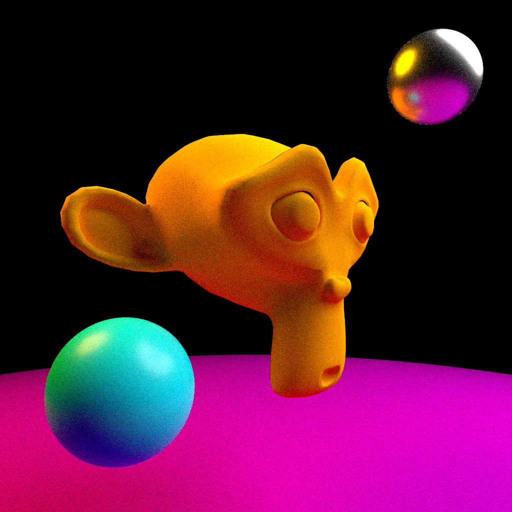

# PathTracer



A CPU path tracer I wrote from scratch in modern C++ to explore computer graphics, data structures, and multithreaded programming.

## Features

- Monte Carlo path tracing with adaptive ray pruning
- Multithreaded rendering via a tile queue
- BVH-based BLAS/TLAS acceleration structures for fast ray-scene intersection
- Instancing, so a single mesh can be reused with different transforms/materials
- Diffuse, metal, dielectric, plastic, emissive, and "uber" materials via BSDFs
- OBJ mesh loading
- PPM image output

## Building

Requires CMake 3.15+ and a C++20 compiler. Catch2 is fetched automatically for the test suite.

```sh
cmake -B build
cmake --build build --config Release
```

## Running

```sh
./build/PathTracer > renders/output.ppm
```

The scene, camera, and render settings (image size, samples per pixel, thread count, etc.) are currently configured directly in `src/main.cpp`.

## Testing

```sh
./build/unit_tests
```
